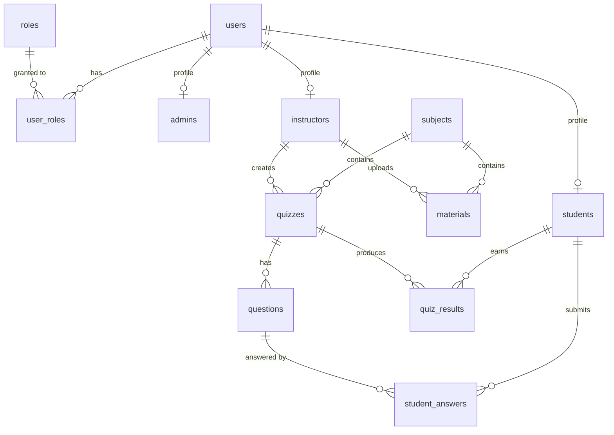

# Database Relationship Explanation

StudyNC implements the **13 entities of the documented ERD** without adding or removing tables. Both DBMSs use the same table names, column names, keys and relationships.

## Entity–relationship diagram

`audit_logs` deliberately has **no foreign keys**. It is written by triggers and must keep its history even if the rows it refers to change later.

## Tables (ERD data stores D1–D9)

| # | Table | Primary key | Foreign keys | Other keys / rules |
|---|---|---|---|---|
| D1 | users | user_id `USR0000001` | – | UNIQUE username, UNIQUE email, status Active/Inactive, password_hash ≥ 60 chars |
| D2 | roles | role_id `ROL0000001` | – | UNIQUE role_name ∈ {Administrator, Instructor, Student} |
| – | user_roles | (user_id, role_id) | user_id→users (CASCADE), role_id→roles (RESTRICT) | many-to-many link |
| – | admins | admin_id `ADM…` | user_id→users | UNIQUE user_id (1:1) |
| – | instructors | instructor_id `INS…` | user_id→users | UNIQUE user_id (1:1) |
| – | students | student_id `STU…` | user_id→users | UNIQUE user_id (1:1) |
| D3 | subjects | subject_id `SUB…` | – | UNIQUE subject_name |
| D4 | materials | material_id `MAT…` | subject_id→subjects, instructor_id→instructors | title and file_path not blank |
| D5 | quizzes | quiz_id `QUZ…` | subject_id→subjects, instructor_id→instructors | title not blank |
| D6 | questions | question_id `QST…` | quiz_id→quizzes | CHECK correct_answer ∈ {option_a..d}; options distinct |
| D7 | student_answers | answer_id `ANS…` | student_id→students, question_id→questions | UNIQUE (student_id, question_id) |
| D8 | quiz_results | result_id `RES…` | student_id→students, quiz_id→quizzes | UNIQUE (student_id, quiz_id); 0 ≤ score ≤ 100 |
| D9 | audit_logs | log_id (int, auto) | none (by design) | action_type ∈ {INSERT, UPDATE, DELETE, LOGIN_SUCCESS, LOGIN_FAILED}; append-only |

## Relationship rules and orphan prevention

* **ON DELETE RESTRICT** on every foreign key except `user_roles.user_id` (CASCADE). A subject that still has materials or quizzes, a quiz that still has questions, or a question that has answers **cannot be deleted**. This rule is tested in CON-02, CON-03, SUB-07 and QUZ-13.
* **ON UPDATE RESTRICT:** primary keys never change.
* **Users are never deleted.** The CRUD matrix has no D on Users, so accounts are deactivated with `status = 'Inactive'` and their history is kept.
* **Quiz deletion** (allowed only while nobody has answered the quiz) deletes the questions explicitly and then the quiz. Cascading would be simpler, but **MySQL does not fire triggers for rows removed by a cascading foreign key**, so those deletions would be missing from the audit log. Explicit deletes keep auditing identical in both DBMSs (QUZ-18).
* **Ownership:** a material or quiz belongs to the instructor who created it (`instructor_id`). Only that instructor can change it, and the procedures enforce this.

## How the ERD maps to the six modules

| Module (DFD process) | Tables written | Tables read |
|---|---|---|
| 1.0 User Management | users, user_roles, admins/instructors/students | roles |
| 2.0 Subject Management | subjects | – |
| 3.0 Learning Material Management | materials | subjects, instructors |
| 4.0 Quiz Management | quizzes, questions | subjects, instructors |
| 5.0 Assessment Processing | student_answers, quiz_results | quizzes, questions, students |
| 6.0 Reporting & Monitoring | – (audit_logs is written by triggers) | all tables |

## Data types: MySQL vs PostgreSQL

| Concept | MySQL 8 | PostgreSQL 16 |
|---|---|---|
| Ids | VARCHAR(10); next value from `MAX()` with a locking read (`FOR UPDATE`) in `sp_next_id` | VARCHAR(10) DEFAULT `'USR' ‖ lpad(nextval(seq))` (sequences) |
| status | `ENUM('Active','Inactive')` | `CREATE TYPE user_status AS ENUM` |
| is_correct | BOOLEAN (= TINYINT(1)) | BOOLEAN |
| score | DECIMAL(5,2) | NUMERIC(5,2) |
| timestamps | TIMESTAMP | TIMESTAMPTZ |
| audit row images | JSON | JSONB (+ GIN index) |
| audit log_id | INT AUTO_INCREMENT | INTEGER GENERATED ALWAYS AS IDENTITY |
| case-insensitive uniqueness | `utf8mb4_0900_ai_ci` collation | UNIQUE index on `lower(column)` |
| FK indexes | created automatically | created explicitly in file 03 |
